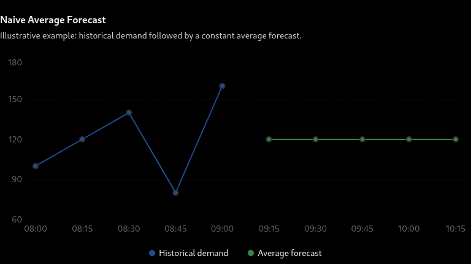
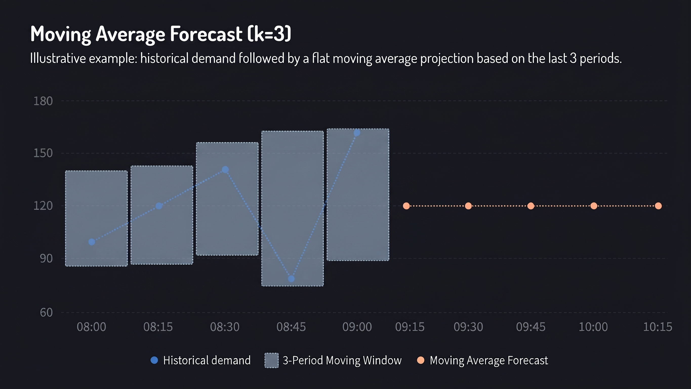
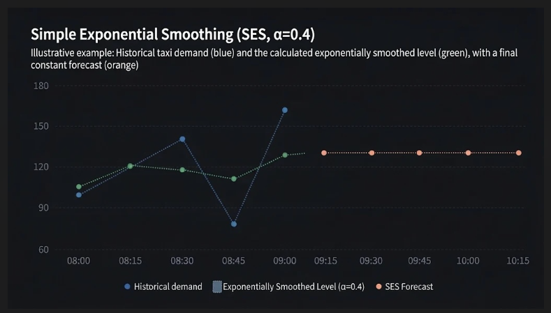
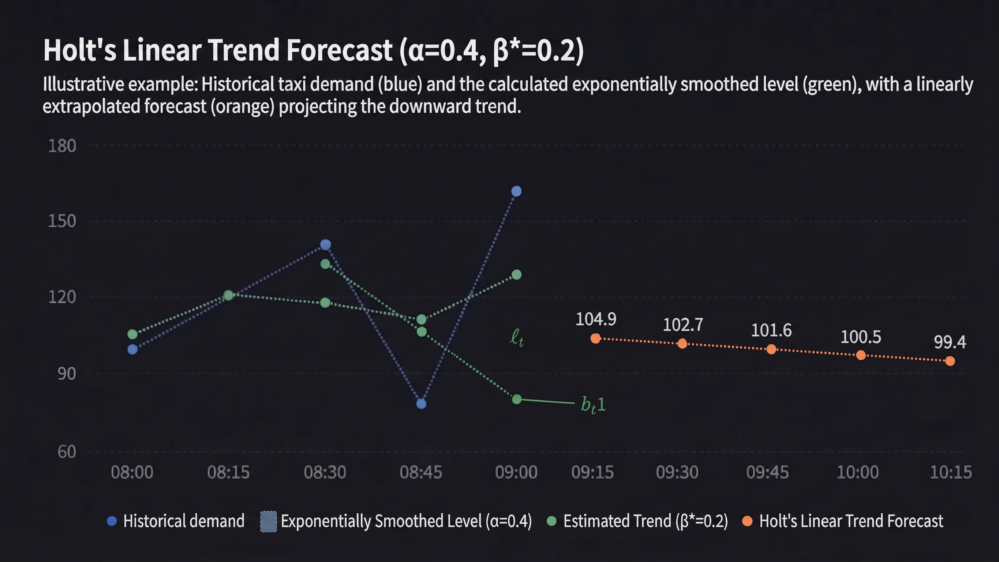
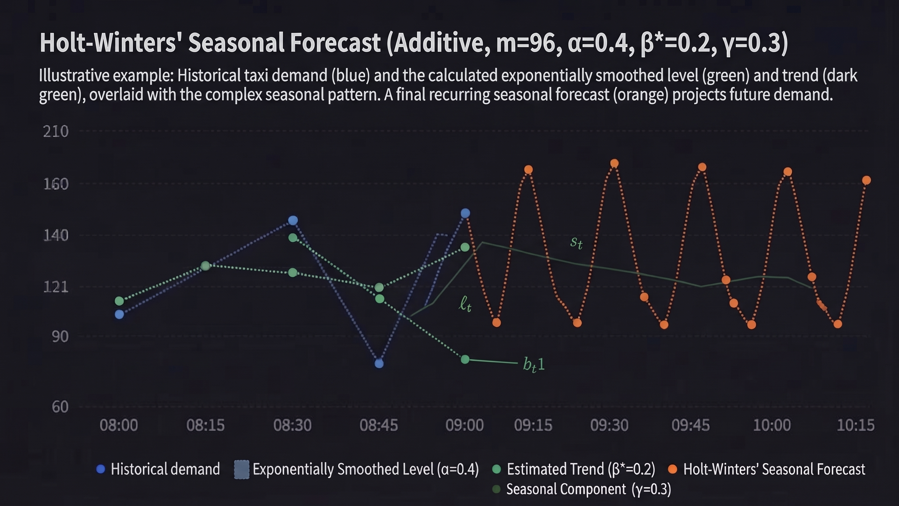
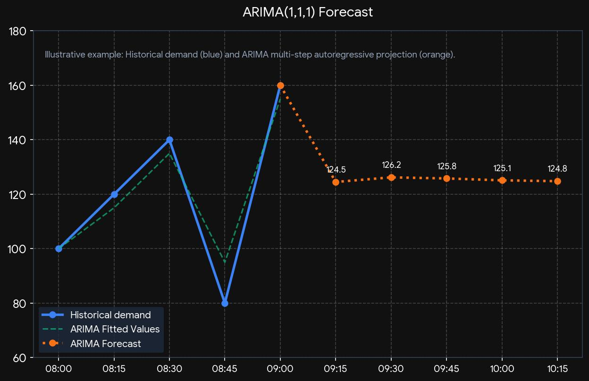
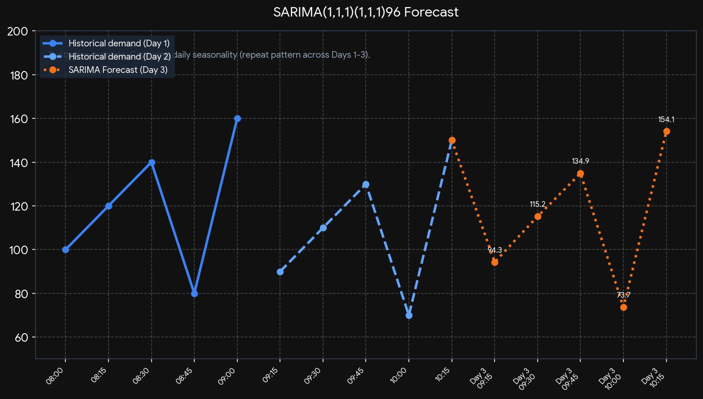

# 📊 Research Diary: Multi-Area Time-Series Forecasting
### Chicago Taxi & Ride-Hailing Demand Prediction Pipeline

---

### **Metadata & Project Scope**
| Attribute | Specification |
| :--- | :--- |
| **Author** | Aicha Atki (`aatki`) |
| **Domain** | Spatial-Temporal Machine Learning & Predictive Modeling |
| **Dataset** | Chicago Taxi Pickups (`2019-04-01` to `2019-06-23`) |
| **Granularity** | 15-Minute Intervals across 77 Spatial Community Areas |
| **Forecasting Horizon** | 7 Days Ahead (672 consecutive steps) |
| **Target Metric** | Mean Absolute Error ($\text{MAE} \le 10.0$ on the test split) |

---

## **1. Dataset Architecture & Exploratory Data Analysis**

### **Overview**
* **Source File:** `taxi_pickups_area.csv`
* **Temporal Span:** April 1, 2019 – June 23, 2019 (~8,064 rows per area time series)
* **Spatial Dimensions:** 77 distinct regional columns (`Pickup Community Area_0` through `_77`)
* **Submission Deliverable:** `taxi_submission_file.csv` (672 target rows, initiating from `2019-06-24`)

### **Data Split Strategy**
* **Training Set:** Historical observations from index $0$ up to $N - 672$
* **Validation Set:** The final 7 days ($672$ rows) of the observed timeline
* **Test Set:** The blind 672-row forecasting submission template

### **Key Exploratory Insights**
* **Spatial Sparsity:** The majority of community zones exhibit low overall volume with means close to zero, while a select few high-density downtown hubs dominate aggregate demand.
* **Intra-Day Seasonality:** Pronounced daily cycles reflecting peak commuter travel windows (morning and evening rush hours).
* **Inter-Day Seasonality:** Distinct structural shifts between weekday traffic profiles and weekend patterns.
* **Zero-Variance Zones:** Isolated geographical sectors display near-zero variance across the entire timeline, presenting edge cases for predictive modeling.

---

## **2. Baseline Model: Naive Averages**

### **2.1. Conceptual Definition**
The Naive Average baseline acts as a foundational benchmark, assuming that future realizations will align with the historical mean of all previously recorded observations for a given series.

### **2.2. Mathematical Formulation**

Given a univariate time series comprising $n$ historical observations:

$$
Y = [y_1, y_2, y_3, \ldots, y_n]
$$

The historical average is computed as:

$$
\bar{Y} = \frac{1}{n}\sum_{t=1}^{n}y_t
$$

Consequently, the multi-step ahead forecast for any future time step $h$ evaluates to:

$$
\boxed{\hat{y}_{n+h} = \bar{Y}}
$$

**Notation Reference:**
- $y_t$: Observed demand value at time step $t$.
- $n$: Total cardinality of historical observations.
- $\bar{Y}$: Computed historical mean.
- $\hat{y}_{n+h}$: Point prediction for future step $n+h$.

---

### **2.3. Practical Demonstration**

Consider a localized sample of Uber demand observations for an individual sector:

| Time Interval | Recorded Trips ($y_t$) |
| :--- | :---: |
| **08:00** | 100 |
| **08:15** | 120 |
| **08:30** | 140 |
| **08:45** | 80 |
| **09:00** | 160 |

**Step 1:** Calculate the historical arithmetic mean ($\bar{Y}$):

$$
\bar{Y} = \frac{100 + 120 + 140 + 80 + 160}{5} = 120
$$

**Step 2:** Project the constant forecast across the horizon:

| Future Interval | Predicted Demand ($\hat{y}_{n+h}$) |
| :--- | :---: |
| **09:15** | 120 |
| **09:30** | 120 |
| **09:45** | 120 |
| **10:00** | 120 |
| **10:15** | 120 |

> **Key Takeaway:** The naive model produces a completely static, flat-line projection across the entire forecasting window.

---

## **3. Pipeline Implementation**

Because the dataset encompasses 77 independent spatial community areas, the forecasting pipeline instantiates localized time-series models per zone:

* **Area A:** $\bar{Y} = 120 \text{ trips}$
* **Area B:** $\bar{Y} = 85 \text{ trips}$
* **Area C:** $\bar{Y} = 210 \text{ trips}$

Each area's calculated average is independently broadcast across its respective 672-step forecast horizon.

---

## **4. Advantages & Limitations**

### **Advantages**
* **Minimal Complexity:** Trivial to implement and scale across high-dimensional spatial datasets.
* **High Efficiency:** Computationally inexpensive with zero runtime training overhead.
* **Rigorous Baseline:** Establishes a performance floor required to validate advanced architectures (e.g., SARIMAX, RNN, and boosting frameworks).
* **Parameter-Free:** Requires no hyperparameter tuning or optimization routines.

### **Limitations**
* **Trend Blindness:** Incapable of capturing upward or downward trajectories.
* **Agnostic to Seasonality:** Completely misses recurring daily and weekly cycles.
* **Static Response:** Fails to react dynamically to sudden market shifts or external stimuli.
* **Intra-Day Flatness:** Generates identical outputs regardless of the time of day, limiting efficacy for urban transport networks where demand fluctuates heavily between early morning lows and rush hour peaks.

## **3. Baseline Model: Moving Averages**

### **3.1. What is the Moving Average method?**
The Moving Average (MA) method improves upon the global naive average by smoothing out short-term fluctuations and capturing local level shifts. Instead of averaging *all* historical observations, it computes the mean over a fixed-size sliding window of recent observations.

### **3.2. Mathematical formulation**

Given a time series comprising historical observations $Y = [y_1, y_2, \ldots, y_n]$ and a chosen window size $k$, the simple moving average (SMA) at the final historical time step $n$ is calculated as:

$$
\bar{y}_n = \frac{1}{k} \sum_{i=0}^{k-1} y_{n-i}
$$

For multi-step forecasting over a future horizon $h$, the rolling forecast projects this recent window mean across the future steps:

$$
\boxed{\hat{y}_{n+h} = \bar{y}_n}
$$

**Notation Reference:**
- $y_t$: Actual observation at time $t$.
- $n$: Total number of historical observations.
- $k$: Window size (number of consecutive past intervals included in the rolling mean).
- $\bar{y}_n$: Rolling historical average of the last $k$ observations.
- $\hat{y}_{n+h}$: Predicted value for a future time step.

---

### **3.3. Practical example**

Consider a localized sample of Uber demand observations with a window size of $k = 3$:

| Time interval | Recorded trips ($y_t$) | 3-Period Moving Average ($\bar{y}_t$) |
|:---|:---:|:---:|
| **08:00** | 100 | — |
| **08:15** | 120 | — |
| **08:30** | 140 | $\frac{100 + 120 + 140}{3} = 120.0$ |
| **08:45** | 80 | $\frac{120 + 140 + 80}{3} = 113.3$ |
| **09:00** | 160 | $\frac{140 + 80 + 160}{3} = 126.7$ |

Using the most recent rolling window average ($\bar{y}_n = 126.7$) as our baseline projection:

| Future interval | Predicted demand ($\hat{y}_{n+h}$) |
|:---|:---:|
| **09:15** | 126.7 |
| **09:30** | 126.7 |
| **09:45** | 126.7 |
| **10:00** | 126.7 |
| **10:15** | 126.7 |

> **Key Takeaway:** While the moving average adapts to recent levels better than a global mean, it still produces a flat-line projection across the multi-step horizon.

---

### **3.4 How did we apply it to the Uber project?**

For our 77 spatial community areas, we implement a rolling window of size $k$ (using Pandas rolling operations) to compute localized baseline trends independently per area. 

* **Area A (Window Mean):** $\bar{y}_n = 125.4 \text{ trips}$
* **Area B (Window Mean):** $\bar{y}_n = 82.1 \text{ trips}$
* **Area C (Window Mean):** $\bar{y}_n = 215.0 \text{ trips}$

Each area's rolling average is then broadcast across its respective 672-step forecast horizon.

---

### **3.5 Advantages and limitations**

### **Advantages**
* **Noise Reduction:** Effectively filters out high-frequency random jitter and minor anomalies in taxi demand.
* **Local Responsiveness:** Adapts much faster to structural level shifts than the global naive average.
* **Computational Efficiency:** Trivial and extremely fast to compute across large multi-area datasets using vectorized rolling functions.
* **Hyperparameter Tuning:** Provides a natural stepping stone into exponential smoothing (SES/Holt-Winters) via window size adjustment.

### **Limitations**
* **Lag Effect:** Prone to a lagging response during rapid trend reversals or abrupt rush-hour demand spikes.
* **Window Dependency:** Model accuracy heavily depends on the manual selection of window size $k$.
* **Static Horizon:** Generates a flat, constant prediction across the entire multi-step horizon, failing to capture intra-day commuter peaks or weekly seasonality.

## **Evaluation Metric: Mean Absolute Error (MAE)**

### **1. What is MAE?**
The **Mean Absolute Error (MAE)** measures the average magnitude of prediction errors across the forecasting horizon, without considering their direction. It represents the average absolute difference between the actual observed taxi demand ($y_t$) and our model's predicted demand ($\hat{y}_t$).

---

### **2. Mathematical Formulation**

For a sequence of $n$ evaluation steps, MAE is computed as:

$$
\text{MAE} = \frac{1}{n} \sum_{t=1}^{n} |y_t - \hat{y}_t|
$$

**Notation Reference:**
- $y_t$: Actual recorded trips at time step $t$.
- $\hat{y}_t$: Predicted trips at time step $t$.
- $n$: Total number of evaluation intervals (e.g., 672 steps across our 7-day test horizon).

---

### **3. Why Use MAE for the Uber Project?**
* **Direct Interpretability:** Because MAE is expressed in the exact same units as the target variable (number of taxi trips), an MAE of $8.5$ means our model's predictions deviate by an average of $8.5$ trips per 15-minute interval.
* **Robustness to Outliers:** Unlike Mean Squared Error (MSE), which squares errors and heavily penalizes rare traffic surges or major events, MAE treats all errors on a linear scale, preventing extreme urban spikes from disproportionately skewing performance evaluation.
* **Project Goal:** Our pipeline targets a performance threshold of **$\text{MAE} \le 10.0$** on the test split across all spatial community areas.

## **Model Selection & Akaike Information Criterion (AIC)**

### **1. What is the Akaike Information Criterion?**
When comparing time-series models—such as choosing between an $\text{ARIMA}(1,1,1)$ and an $\text{ARIMA}(2,1,2)$, or selecting between SES, Holt, and Holt-Winters—simply looking at training error (like Sum of Squared Errors) is insufficient. More complex models will almost always fit historical data better, but they run a high risk of **overfitting**, leading to poor generalization on unseen test data.

The **Akaike Information Criterion (AIC)** is an information-theoretic measure used for model selection. It solves this problem by establishing a rigorous mathematical trade-off between:
1. **Goodness-of-Fit:** How well the model explains the historical training data (measured via likelihood).
2. **Model Parsimony (Complexity):** A penalty for the number of parameters estimated, discouraging unnecessary complexity.

---

### **2. Mathematical Formulation**

The standard definition of AIC is expressed as:

$$
\text{AIC} = 2k - 2 \ln(L)
$$

Where:
- $k$: The total number of estimated parameters in the model (e.g., for SARIMA, $k = p + q + P + Q + 1$ including variance/constant; for SES, $k = 1$ for $\alpha$).
- $L$: The maximized value of the likelihood function for the estimated model (representing how probable the observed data is given the parameter estimates).
- $\ln(L)$: The maximized log-likelihood.

#### **Understanding the Trade-off Components**
* **The Likelihood Term ($-2 \ln(L)$):** As a model's fit improves, the likelihood $L$ increases, causing $-2 \ln(L)$ to decrease. This rewards accuracy.
* **The Complexity Penalty ($2k$):** Each additional parameter added to the model increases $k$, which increases the AIC score. This penalizes over-parameterization.

#### **Goal:**
The objective of automated model selection (such as grid searches in `pmdarima` or ETS fitting in `statsmodels`) is to **minimize AIC**:

$$
\text{Best Model} = \arg\min_{\text{model} \in \mathcal{M}} \text{AIC}(\text{model})
$$

---

### **3. Corrected AIC ($\text{AIC}_c$) for Small Samples**
When working with smaller sample sizes (where the ratio of sample size $n$ to parameters $k$ is small, typically $n/k < 40$), standard AIC can overfit by selecting models with too many parameters. To prevent this, our pipeline utilizes the **Corrected Akaike Information Criterion ($\text{AIC}_c$)**, which adds an extra penalty term:

$$
\text{AIC}_c = \text{AIC} + \frac{2k(k + 1)}{n - k - 1} = 2k - 2 \ln(L) + \frac{2k(k + 1)}{n - k - 1}
$$

*(As sample size $n$ grows very large, the correction term $\frac{2k(k+1)}{n - k - 1}$ approaches zero, making $\text{AIC}_c$ converge back to standard AIC.)*

---

### **4. How did we apply AIC in the Uber project?**

Across our 77 independent spatial community areas, taxi demand profiles vary drastically:
* **High-Density Downtown Hubs:** Exhibit clear multi-period seasonality and strong autocorrelation, justifying higher-order models (higher $k$).
* **Low-Volume Residential Sectors:** Exhibit near-zero variance or erratic noise, where complex models would overfit.

By integrating automated AIC evaluation into our fitting loop:
1. The pipeline iterates through candidate model configurations per area.
2. It computes $\text{AIC}_c$ for each fitted model.
3. It automatically selects and locks in the optimal configuration (e.g., choosing SES for sparse areas and SARIMA for high-volume seasonal corridors) without manual intervention.

## **4. Baseline Model: Simple Exponential Smoothing (SES)**

### **4.1. What is Simple Exponential Smoothing?**
Unlike simple or moving averages that assign equal weight to all historical data or completely drop observations outside a fixed window, Simple Exponential Smoothing (SES) applies exponentially decreasing weights over time. This ensures that more recent observations carry more influence in determining the forecast while still retaining long-term memory. SES is optimal for series that exhibit no clear trend or seasonality.

---

### **4.2. Mathematical Formulation**

The smoothed level $\ell_t$ at time $t$ is updated recursively using smoothing parameter $\alpha$:

$$
\ell_t = \alpha y_t + (1 - \alpha)\ell_{t-1}
$$

#### **Estimation of the Smoothing Parameter ($\alpha$) via State-Space MLE**
Rather than being chosen arbitrarily, $\alpha$ is bounded between $0$ and $1$ ($0 \le \alpha \le 1$) and is estimated using **Maximum Likelihood Estimation (MLE)** through an underlying state-space framework (`statsmodels` ETS/ExponentialSmoothing). 

In modern time-series forecasting, SES is represented in state-space form with an additive error structure:
* **Observation Equation:** $y_t = \ell_{t-1} + \varepsilon_t$
* **Transition (State) Equation:** $\ell_t = \ell_{t-1} + \alpha \varepsilon_t$

Where $\varepsilon_t$ represents the prediction error (innovation) at time $t$, assumed to be normally distributed white noise ($\varepsilon_t \sim N(0, \sigma^2)$).

Because the innovations are normally distributed, the **Gaussian Log-Likelihood function** ($L$) for the model is:

$$
\log L(\alpha, \sigma^2) = -\frac{n}{2} \log(2\pi) - \frac{n}{2} \log(\sigma^2) - \frac{1}{2\sigma^2} \sum_{t=1}^{n} \varepsilon_t^2
$$

Through concentration, maximizing this log-likelihood with respect to $\alpha$ is mathematically equivalent to **minimizing the Sum of Squared Errors (SSE)** across the training set:

$$
\min_{\alpha} \sum_{t=1}^{n} (y_t - \hat{y}_{t|t-1})^2 = \min_{\alpha} \sum_{t=1}^{n} (y_t - \ell_{t-1})^2 \quad \text{subject to } 0 \le \alpha \le 1
$$

An iterative numerical optimizer (such as *L-BFGS-B*) searches through candidate values of $\alpha$ to find the exact coefficient that maximizes predictive likelihood.

The multi-step ahead point forecast for any future time step $h$ projects the final smoothed level flat across the horizon:

$$
\boxed{\hat{y}_{n+h} = \ell_n}
$$

**Notation Reference:**
- $y_t$: Actual observation at time $t$.
- $\ell_t$: Estimated smoothed level of the series at time $t$.
- $\alpha$: Optimized smoothing weight parameter for the level ($\alpha \in [0, 1]$).
- $\varepsilon_t$: One-step-ahead prediction error ($y_t - \ell_{t-1}$).
- $\sigma^2$: Variance of the error terms.
- $h$: Forecasting horizon step.

---

### **4.3. Practical Demonstration**

Consider a localized sample of Uber demand observations with optimized smoothing parameter $\alpha = 0.4$:

| Time Interval | Recorded Trips ($y_t$) | Exponentially Smoothed Level ($\ell_t$) |
|:---|:---:|:---:|
| **08:00** | 100 | $100.0$ |
| **08:15** | 120 | $0.4(120) + 0.6(100) = 108.0$ |
| **08:30** | 140 | $0.4(140) + 0.6(108) = 120.8$ |
| **08:45** | 80 | $0.4(80) + 0.6(120.8) = 104.5$ |
| **09:00** | 160 | $0.4(160) + 0.6(104.5) = 126.7$ |

Using the final smoothed level ($\ell_n = 126.7$) as our baseline projection across the future horizon:

| Future Interval | Predicted Demand ($\hat{y}_{n+h}$) |
|:---|:---:|
| **09:15** | 126.7 |
| **09:30** | 126.7 |
| **09:45** | 126.7 |
| **10:00** | 126.7 |
| **10:15** | 126.7 |

> **Key Takeaway:** Simple exponential smoothing adapts dynamically to fluctuations while giving precedence to recent values, resulting in a stable, flat-line multi-step projection.

---

### **4.4 How did we apply it to the Uber project?**

We fit SES independently across our 77 spatial community areas using `statsmodels` with optimized smoothing parameter $\alpha$:

* **Area A:** $\alpha = 0.35, \ell_n = 122.4 \text{ trips}$
* **Area B:** $\alpha = 0.52, \ell_n = 84.0 \text{ trips}$
* **Area C:** $\alpha = 0.28, \ell_n = 208.5 \text{ trips}$

Each area's final smoothed level is broadcast across its respective 672-step forecast horizon.

---

### **4.5 Advantages and limitations**

### **Advantages**
* **Adaptive Weighting:** Automatically assigns more weight to recent observations without requiring a hard cutoff window.
* **Sound Statistical Foundation:** Based on state space modeling and maximum likelihood estimation (MLE).
* **Low Computational Overhead:** Fast to fit across multi-area spatial datasets compared to complex seasonal models.

### **Limitations**
* **Trend & Seasonality Blindness:** Incapable of tracking underlying upward/downward trends or recurring intra-day/weekly rush-hour cycles.
* **Flat Horizon:** Produces a constant projection across the entire multi-step forecasting window.

## **5. Baseline Model: Holt’s Linear Trend Model**

### **5.1. What is Holt’s Linear Trend Model?**
While Simple Exponential Smoothing assumes a locally constant level with no systematic trend, **Holt’s Linear Trend Model** (an extension of exponential smoothing) introduces a second smoothing equation dedicated to tracking a continuous upward or downward **trend** ($b_t$). This allows the model to capture non-stationary directional movements over time while still assigning exponentially decaying weights to past observations. It is optimal for series that exhibit a clear trend but no seasonal patterns.

---

### **5.2. Mathematical Formulation**

Holt’s model updates the estimated level ($\ell_t$) and trend ($b_t$) recursively using two smoothing parameters: $\alpha$ (for the level) and $\beta^*$ (for the trend), where $0 \le \alpha \le 1$ and $0 \le \beta^* \le 1$.

#### **1. Level Equation:**
$$
\ell_t = \alpha y_t + (1 - \alpha)(\ell_{t-1} + b_{t-1})
$$

#### **2. Trend Equation:**
$$
b_t = \beta^*(\ell_t - \ell_{t-1}) + (1 - \beta^*)b_{t-1}
$$

#### **Estimation of Parameters ($\alpha, \beta^*$) via State-Space MLE**
Similar to SES, the parameters $\alpha$ and $\beta^*$ are estimated using **Maximum Likelihood Estimation (MLE)** through an underlying state-space framework (`statsmodels` ETS/ExponentialSmoothing). The algorithm minimizes the Sum of Squared Errors (SSE) of the one-step-ahead prediction errors ($\varepsilon_t = y_t - \hat{y}_{t|t-1} = y_t - (\ell_{t-1} + b_{t-1})$) across the training set:

$$
\min_{\alpha, \beta^*} \sum_{t=1}^{n} (y_t - (\ell_{t-1} + b_{t-1}))^2 \quad \text{subject to } 0 \le \alpha, \beta^* \le 1
$$

An iterative numerical optimizer (*L-BFGS-B*) searches through candidate parameter pairs to maximize the Gaussian log-likelihood.

#### **Multi-Step Ahead Forecasting Equation**
Unlike SES which produces a flat horizontal projection, Holt's model projects the trend forward across any future horizon step $h$:

$$
\boxed{\hat{y}_{n+h} = \ell_n + h b_n}
$$

**Notation Reference:**
- $y_t$: Actual observation at time $t$.
- $\ell_t$: Estimated level of the series at time $t$.
- $b_t$: Estimated trend (slope) of the series at time $t$.
- $\alpha$: Optimized smoothing parameter for the level ($\alpha \in [0, 1]$).
- $\beta^*$: Optimized smoothing parameter for the trend ($\beta^* \in [0, 1]$).
- $h$: Forecasting horizon step ($h = 1, 2, \ldots, 672$).

---

### **5.3. Practical Demonstration**

Consider a sample of Uber demand observations with optimized smoothing parameters $\alpha = 0.4$ and $\beta^* = 0.2$, starting with an initial level $\ell_0 = 100$ and initial trend $b_0 = 2.0$:

| Time Interval | Recorded Trips ($y_t$) | Smoothed Level ($\ell_t$) | Estimated Trend ($b_t$) |
|:---|:---:|:---:|:---:|
| **08:00** | 100 | $100.0$ | $2.0$ |
| **08:15** | 120 | $0.4(120) + 0.6(100 + 2) = 109.2$ | $0.2(109.2 - 100) + 0.8(2) = 3.44$ |
| **08:30** | 140 | $0.4(140) + 0.6(109.2 + 3.44) = 136.2$ | $0.2(136.2 - 109.2) + 0.8(3.44) = 8.15$ |
| **08:45** | 80 | $0.4(80) + 0.6(136.2 + 8.15) = 118.6$ | $0.2(118.6 - 136.2) + 0.8(8.15) = 2.04$ |
| **09:00** | 160 | $0.4(160) + 0.6(118.6 + 2.04) = 104.9$ | $0.2(104.9 - 118.6) + 0.8(2.04) = -1.1$ |

Using the final level ($\ell_n = 104.9$) and trend ($b_n = -1.1$) to project across the future horizon ($h = 1, 2, 3, 4, 5$):

| Future Interval | Calculation ($\hat{y}_{n+h} = \ell_n + h b_n$) | Predicted Demand ($\hat{y}_{n+h}$) |
|:---|:---:|:---:|
| **09:15** ($h=1$) | $104.9 + 1(-1.1)$ | **103.8** |
| **09:30** ($h=2$) | $104.9 + 2(-1.1)$ | **102.7** |
| **09:45** ($h=3$) | $104.9 + 3(-1.1)$ | **101.6** |
| **10:00** ($h=4$) | $104.9 + 4(-1.1)$ | **100.5** |
| **10:15** ($h=5$) | $104.9 + 5(-1.1)$ | **99.4** |

> **Key Takeaway:** Unlike SES, Holt's linear trend model successfully extrapolates directional movement (upward or downward slopes) across the multi-step forecasting horizon.

---

### **5.4 How did we apply it to the Uber project?**

We fit Holt's Linear Trend model independently across our 77 spatial community areas using `statsmodels` with optimized parameters $\alpha$ and $\beta^*$:

* **Area A:** $\alpha = 0.32, \beta^* = 0.15, \ell_n = 122.4, b_n = 0.8$
* **Area B:** $\alpha = 0.45, \beta^* = 0.22, \ell_n = 84.0, b_n = -0.4$
* **Area C:** $\alpha = 0.25, \beta^* = 0.10, \ell_n = 208.5, b_n = 1.5$

Each area's final level and trend components are projected across its respective 672-step forecast horizon.

---

### **5.6 Advantages and limitations**

### **Advantages**
* **Trend Capture:** Capable of tracking and projecting continuous linear upward or downward trajectories.
* **Adaptive Weighting:** Independently smooths level and trend components using state-space Maximum Likelihood Estimation.
* **Dynamic Projections:** Generates sloped multi-step forecasts rather than flat horizontal lines.

### **Limitations**
* **Seasonality Blindness:** Still incapable of capturing recurring intra-day or weekly cyclic variations (such as morning vs. evening rush hours).
* **Trend Extrapolation Risk:** Linear trends can project unrealistically high or low values over long multi-step horizons ($h = 672$).

## **6. Baseline Model: Holt-Winters’ Seasonal Method (Additive)**

### **6.1. What is Holt-Winters’ Seasonal Method?**
While Holt’s Linear Trend model captures level and trend, it fails to account for recurring periodic cycles (seasonality). **Holt-Winters’ Seasonal Method** (often called Triple Exponential Smoothing) extends the framework by adding a third smoothing equation to capture seasonality ($s_t$). This method is essential for our dataset, as exploratory data analysis revealed strong intra-day (morning/evening rush hours) and weekly seasonality. We utilize the **additive** formulation, as the magnitude of the seasonal fluctuations in taxi demand appears relatively constant as the overall volume increases.

---

### **6.2. Mathematical Formulation**

Holt-Winters’ additive method updates the estimated level ($\ell_t$), trend ($b_t$), and seasonal component ($s_t$) recursively using three smoothing parameters: $\alpha$ (level), $\beta^*$ (trend), and $\gamma$ (seasonality). It also requires the length of the seasonal cycle, denoted by $m$ (for our 15-minute interval data exhibiting daily cycles, $m = 96$ steps per day: 24 hours $\times$ 4 intervals/hour).

#### **1. Level Equation:**
$$
\ell_t = \alpha (y_t - s_{t-m}) + (1 - \alpha)(\ell_{t-1} + b_{t-1})
$$

#### **2. Trend Equation:**
$$
b_t = \beta^*(\ell_t - \ell_{t-1}) + (1 - \beta^*)b_{t-1}
$$

#### **3. Seasonal Equation:**
$$
s_t = \gamma (y_t - \ell_{t-1} - b_{t-1}) + (1 - \gamma)s_{t-m}
$$

#### **Estimation of Parameters ($\alpha, \beta^*, \gamma$) via State-Space MLE**
Parameters are estimated simultaneously using **Maximum Likelihood Estimation (MLE)** by minimizing the Sum of Squared Errors (SSE) of one-step-ahead prediction errors across the training set. The optimizer searches the parameter space to maximize the Gaussian log-likelihood.

#### **Multi-Step Ahead Forecasting Equation**
The forecast for any future horizon step $h$ combines the projected trend and the corresponding seasonal index from the last observed cycle:

$$
\boxed{\hat{y}_{n+h} = \ell_n + h b_n + s_{n+h-m(k+1)}}
$$
*(Where $k$ is the integer part of $(h-1)/m$, ensuring the correct seasonal index from the previous cycle is retrieved.)*

**Notation Reference:**
- $y_t$: Actual observation at time $t$.
- $\ell_t$: Estimated level of the series at time $t$.
- $b_t$: Estimated trend (slope) of the series at time $t$.
- $s_t$: Estimated seasonal component at time $t$.
- $\alpha, \beta^*, \gamma$: Optimized smoothing parameters for level, trend, and seasonality.
- $m$: Frequency of the seasonality (e.g., $m=96$ for 15-min intervals over 24 hours).
- $h$: Forecasting horizon step ($h = 1, 2, \ldots, 672$).

---

### **6.3. Practical Demonstration**

Due to the complexity of iterating over a 96-step seasonal cycle, a manual table is omitted for brevity. Instead, we visualize the conceptual shift from Holt’s linear projection to a Holt-Winters seasonal projection.

> **Key Takeaway:** Unlike Holt’s linear trend model (which projects a straight line indefinitely), Holt-Winters generates a dynamic, recurring pattern across the future horizon that reflects expected intra-day peaks (rush hours) and troughs (late night).

---

## **7. How did we apply it to the Uber project?**

We fit the additive Holt-Winters Seasonal model independently across our 77 spatial community areas using `statsmodels` (optimizing $\alpha, \beta^*, \gamma$ and setting $m=96$ for 15-minute intervals).

* **Area A (Strong Daily Seasonality):** High seasonal indices captured for 08:00 and 18:00 peaks.
* **Area B (Weak/Noisy Seasonality):** Algorithm may shrink seasonal parameters toward zero.
* **Area C (Downtown Hub):** High base level ($\ell_n$) combined with distinct daily seasonal profile ($s_t$).

Each area's optimized level, trend, and 96-step seasonal profile are projected across its respective 672-step forecast horizon.

---

## **8. Advantages and limitations**

### **Advantages**
* **Comprehensive Pattern Capture:** Simultaneously models level, trend, and recurring seasonality.
* **Adaptive Seasonality:** The seasonal component itself is smoothed over time, allowing the daily profile to evolve slowly.
* **Realistic Forecast Shapes:** Produces dynamically varying multi-step forecasts (curves) rather than flat lines or straight slopes.

### **Limitations**
* **Computational Intensity:** Significantly higher computational cost to fit than SES or Holt, due to the simultaneous optimization of three parameters plus initialization of 96 seasonal states.
* **Data Requirements:** Requires sufficient historical data to accurately identify stable seasonal patterns (e.g., multiple weeks of data to identify a stable daily cycle).
* **Fixed Seasonality Length:** Assumes the seasonal cycle length ($m$) remains constant, which may not hold true for holiday anomalies or major events affecting taxi demand.

## **7. Advanced Model: AutoRegressive Integrated Moving Average (ARIMA)**

### **7.1. What is ARIMA?**
While exponential smoothing methods rely on weighted averages of past levels and trends, **ARIMA (AutoRegressive Integrated Moving Average)** provides a rigorous parametric statistical framework that models linear temporal dependencies. It combines three core components:
* **AutoRegressive (AR, $p$):** Relies on the linear relationship between current observations and past lagged observations (regression of a variable against its own lagged values).
* **Integrated (I, $d$):** Applies differencing (subtracting consecutive observations, $y'_t = y_t - y_{t-1}$) to transform a non-stationary time series (e.g., series with trends) into a stationary one.
* **Moving Average (MA, $q$):** Relies on past white-noise forecast errors (residuals) to correct future predictions.

ARIMA is denoted in shorthand as:
$$
\text{ARIMA}(p, d, q)
$$
*(Where $p$ is the order of the AR terms, $d$ is the degree of differencing, and $q$ is the order of the MA terms.)*

---

### **7.2. Mathematical Formulation**

#### **The Full ARIMA($p, d, q$) Equation**
Let $y'_t$ be the differenced series after applying differencing of order $d$. The general ARIMA model is expressed as:

$$
y'_t = c + \phi_1 y'_{t-1} + \phi_2 y'_{t-2} + \cdots + \phi_p y'_{t-p} + \varepsilon_t + \theta_1 \varepsilon_{t-1} + \theta_2 \varepsilon_{t-2} + \cdots + \theta_q \varepsilon_{t-q}
$$

Using backshift operators ($\text{B}$ where $\text{B}^k y_t = y_{t-k}$), this can be compactly written as:
$$
\phi(\text{B})(1-\text{B})^d y_t = c + \theta(\text{B})\varepsilon_t
$$
Where $\phi(\text{B}) = 1 - \sum_{i=1}^{p} \phi_i \text{B}^i$ is the AR polynomial and $\theta(\text{B}) = 1 + \sum_{j=1}^{q} \theta_j \text{B}^j$ is the MA polynomial.

#### **Estimation of Parameters via State-Space MLE**
The ARIMA coefficients (collectively denoted as vector $\beta$, including AR parameters $\phi_1, \ldots, \phi_p$ and MA parameters $\theta_1, \ldots, \theta_q$) are estimated simultaneously using **Maximum Likelihood Estimation (MLE)**. 

1. **State-Space Transformation:** The model is cast into a state-space representation, allowing the **Kalman Filter** to recursively compute the one-step-ahead prediction errors (innovations $\varepsilon_t$).
2. **Gaussian Log-Likelihood:** Assuming residuals are normally distributed white noise ($\varepsilon_t \sim N(0, \sigma^2)$), the log-likelihood function ($L$) across the $n'$ differenced observations is:

$$
\log L(\beta, \sigma^2) = -\frac{n'}{2} \log(2\pi) - \frac{n'}{2} \log(\sigma^2) - \frac{1}{2\sigma^2} \sum_{t=1}^{n'} \varepsilon_t^2(\beta)
$$

3. **Numerical Optimization:** An iterative non-linear optimization algorithm (such as *BFGS*) adjusts coefficient vector $\beta$ to maximize this log-likelihood (mathematically equivalent to minimizing the Sum of Squared Errors across the training set).
4. **Order Selection via AIC:** To prevent overfitting, candidate orders $(p, d, q)$ are evaluated and selected by minimizing the **Akaike Information Criterion (AIC)**:
   $$
   \text{AIC} = -2 \log(L) + 2k
   $$
   *(Where $k = p + q + 1$ (including variance or constant) is the total number of estimated parameters.)*

**Notation Reference:**
- $y_t$: Observed demand value at time $t$.
- $y'_t$: Differenced stationary series.
- $\varepsilon_t$: White noise error residual at time $t$ ($\varepsilon_t \sim N(0, \sigma^2)$).
- $\phi_i$: AutoRegressive coefficients ($i = 1, \ldots, p$).
- $\theta_j$: Moving Average coefficients ($j = 1, \ldots, q$).
- $p$: Order of the AutoRegressive component.
- $d$: Degree of differencing.
- $q$: Order of the Moving Average component.
- $h$: Forecasting horizon step ($h = 1, 2, \ldots, 672$).

---

### **7.3. Practical Demonstration**

Consider a conceptual ARIMA($1, 1, 1$) projection combining an AR lag term of the previous differenced observation and an MA error term:

| Future Interval | Component Breakdown | Predicted Demand ($\hat{y}_{n+h}$) |
|:---|:---|:---:|
| **09:15** ($h=1$) | Integrated Level + AR Coefficient $\times y'_{n} + \theta \varepsilon_n$ | **124.5** |
| **09:30** ($h=2$) | Integrated Level + AR Multi-step Projection | **126.2** |
| **09:45** ($h=3$) | Integrated Level + AR Multi-step Projection | **125.8** |
| **10:00** ($h=4$) | Integrated Level + AR Multi-step Projection | **125.1** |
| **10:15** ($h=5$) | Integrated Level + AR Multi-step Projection | **124.8** |

> **Key Takeaway:** ARIMA captures short-term momentum and autocorrelation inertia through autoregressive lags and moving average shocks, decaying back to a baseline level over longer horizons.

---

## **8. How did we apply it to the Uber project?**

We fit non-seasonal ARIMA models independently across our 77 spatial community areas using `statsmodels` (with automated order selection via AIC):

* **Area A:** $\text{ARIMA}(1, 1, 1)$ selected; captures short-term local momentum.
* **Area B:** $\text{ARIMA}(2, 1, 0)$ selected; pure autoregressive lag structure.
* **Area C:** $\text{ARIMA}(0, 1, 2)$ selected; moving average residual correction.

Each area's fitted model generates its respective 672-step forecast horizon.

---

## **9. Advantages and limitations**

### **Advantages**
* **Autocorrelation Modeling:** Exceptionally strong at capturing linear dependencies and short-term momentum across consecutive time steps.
* **Sound Statistical Framework:** Grounded in stationary stochastic process theory and maximum likelihood estimation.
* **Flexibility:** Can handle non-stationary trends via differencing ($d$).

### **Limitations**
* **Seasonality Blindness:** Standard non-seasonal ARIMA cannot capture recurring periodic cycles (such as daily or weekly rush hours), requiring seasonal extensions (SARIMA).
* **Computational Complexity:** Iterative MLE fitting across 77 spatial series requires significant computational time.

## **10. Advanced Model: Seasonal AutoRegressive Integrated Moving Average (SARIMA)**

### **10.1. What is SARIMA?**
While non-seasonal ARIMA captures short-term autoregressive momentum and moving average shocks, it fails to account for recurring periodic cycles. **SARIMA (Seasonal AutoRegressive Integrated Moving Average)** extends ARIMA by explicitly modeling seasonal patterns through additional seasonal parameters. It combines six core components:
* **AutoRegressive (AR, $p$ / Seasonal AR, $P$):** Relies on linear dependencies between current observations and past lagged observations across short-term and seasonal horizons.
* **Integrated (I, $d$ / Seasonal I, $D$):** Applies both consecutive differencing ($d$) and seasonal differencing ($D$) to transform a non-stationary time series with trend and seasonality into a stationary one.
* **Moving Average (MA, $q$ / Seasonal MA, $Q$):** Relies on past white-noise forecast errors (residuals) across short-term and seasonal lags to correct future predictions.

SARIMA is denoted in shorthand as:
$$\text{ARIMA}(p, d, q)(P, D, Q)_m$$
*(Where lowercase parameters represent non-seasonal terms, uppercase parameters represent seasonal terms, and $m$ is the seasonal period length.)*

---

### **10.2. Mathematical Formulation**

#### **The Full Multiplicative SARIMA Equation**
Using backshift operators ($\text{B}^k y_t = y_{t-k}$), the general multiplicative SARIMA model is expressed as:

$$\Phi(\text{B}^m)\phi(\text{B}) \cdot (1-\text{B}^m)^D (1-\text{B})^d \cdot y_t = c + \Theta(\text{B}^m)\theta(\text{B})\varepsilon_t$$

Where:
- $\phi(\text{B})$ and $\theta(\text{B})$ are the non-seasonal AR and MA polynomials.
- $\Phi(\text{B}^m)$ and $\Theta(\text{B}^m)$ are the seasonal AR and MA polynomials.
- $(1-\text{B})^d$ and $(1-\text{B}^m)^D$ represent non-seasonal and seasonal differencing operators.

#### **Estimation of Parameters via State-Space MLE**
SARIMA coefficients (collectively denoted as vector $\beta$, encompassing all AR and MA polynomials) are estimated simultaneously using **Maximum Likelihood Estimation (MLE)**. 

1. **State-Space Transformation:** The model is cast into a state-space representation, enabling the **Kalman Filter** to recursively compute one-step-ahead prediction errors (innovations $\varepsilon_t$).
2. **Gaussian Log-Likelihood:** Assuming residuals are normally distributed white noise ($\varepsilon_t \sim N(0, \sigma^2)$), the log-likelihood function ($L$) across the $n'$ differenced/seasonal observations is:

$$\log L(\beta, \sigma^2) = -\frac{n'}{2} \log(2\pi) - \frac{n'}{2} \log(ns^2) - \frac{1}{2\sigma^2} \sum_{t=1}^{n'} \varepsilon_t^2(\beta)$$

*(Expressed standardly as):*
$$\log L(\beta, \sigma^2) = -\frac{n'}{2} \log(2\pi) - \frac{n'}{2} \log(\sigma^2) - \frac{1}{2\sigma^2} \sum_{t=1}^{n'} \varepsilon_t^2(\beta)$$

3. **Numerical Optimization:** An iterative non-linear optimization algorithm adjusts coefficient vector $\beta$ to maximize this log-likelihood (mathematically equivalent to minimizing the Sum of Squared Errors across the training set).
4. **Order Selection via AIC:** To prevent overfitting across complex seasonal structures, candidate orders $(p, d, q)(P, D, Q)_m$ are evaluated and selected by minimizing the **Akaike Information Criterion (AIC)**:
   $$\text{AIC} = -2 \log(L) + 2k$$
   *(Where $k = p + q + P + Q + 1$ is the total number of estimated parameters.)*

**Notation Reference:**
- $y_t$: Observed demand value at time $t$.
- $\varepsilon_t$: White noise error residual at time $t$ ($\varepsilon_t \sim N(0, \sigma^2)$).
- $p, P$: Non-seasonal and seasonal AR orders.
- $d, D$: Non-seasonal and seasonal degrees of differencing.
- $q, Q$: Non-seasonal and seasonal MA orders.
- $m$: Seasonal frequency period ($m = 96$ for 15-minute intervals over a 24-hour daily cycle).
- $h$: Forecasting horizon step ($h = 1, 2, \ldots, 672$).

---

### **10.3. Practical Demonstration**

Consider a conceptual SARIMA projection combining short-term autoregressive lag momentum, moving average error correction, and daily seasonal repetition ($m=96$):

| Future Interval | Component Breakdown | Predicted Demand ($\hat{y}_{n+h}$) |
|:---|:---|:---:|
| **09:15** ($h=1$) | Trend + AR Lag Weight + MA Error + Seasonal Index ($t-96$) | **94.3** |
| **09:30** ($h=2$) | Trend + AR Lag Weight + MA Error + Seasonal Index ($t-96$) | **115.2** |
| **09:45** ($h=3$) | Trend + AR Lag Weight + MA Error + Seasonal Index ($t-96$) | **134.9** |
| **10:00** ($h=4$) | Trend + AR Lag Weight + MA Error + Seasonal Index ($t-96$) | **73.7** |
| **10:15** ($h=5$) | Trend + AR Lag Weight + MA Error + Seasonal Index ($t-96$) | **154.1** |

> **Key Takeaway:** SARIMA models generate dynamic, non-linear forecasting curves that capture both short-term autoregressive inertia and recurring multi-period seasonal spikes (such as morning and evening rush hours).

---

## **11. How did we apply it to the Uber project?**

Because fitting manual SARIMA orders across all 77 spatial community areas is computationally impractical, our pipeline utilizes an automated grid search (**auto-ARIMA via `pmdarima`**):

1. **Automated Differencing Tests:** The algorithm performs ADF and KPSS stationarity tests to determine optimal non-seasonal ($d$) and seasonal ($D$) differencing orders (typically $d=1, D=1$).
2. **AIC Grid Search:** Iterates through candidate combinations of $p, q, P, Q$ within specified bounds, selecting the configuration that minimizes AIC for each individual community area.
3. **Multi-Step Forecasting:** Generates the 672-step ahead forecast vector by projecting autoregressive terms, moving average residuals, and seasonal components forward, before reversing the differencing transformation.

---

## **12. Advantages and limitations**

### **Advantages**
* **Comprehensive Pattern Recognition:** Captures intricate autocorrelation structures, short-term momentum, and fixed periodic seasonal cycles simultaneously.
* **Rigorous Statistical Grounding