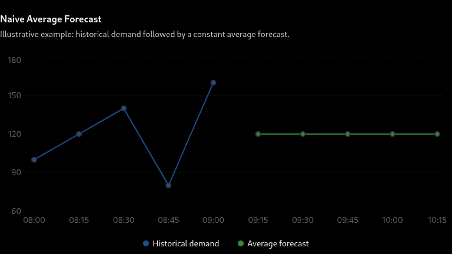

# Research Diary — Uber Taxi Demand Forecasting

**Author:** Aicha Atki *aatki*
**Dataset:** Chicago taxi pickups — 2019-04-01 → 2019-06-23
**Granularity:** 15-minute intervals | **Areas:** 77
**Task:** Forecast the next 7 days (672 intervals) of taxi demand per area  
**Target metric:** Average MAE ≤ 10.0 on the test set

---

## Dataset Overview

| Property | Value |
|----------|-------|
| File | `taxi_pickups_area.csv` |
| Date range | 2019-04-01 → 2019-06-23 |
| Total rows | ~8 064 |
| Areas (columns) | 77 (`Pickup Community Area_0` … `_77`) |
| Interval | 15 minutes |
| Submission file | `taxi_submission_file.csv` (672 rows, starts 2019-06-24) |

**Train / Validation split:**
- Train : first N − 672 rows
- Validation : last 672 rows (7 days)
- Test : 672 rows from the submission template

**Key observations from EDA:**
- Most areas have sparse demand (mean close to 0); a few downtown areas dominate
- Clear daily seasonality (peaks during morning/evening rush hours)
- Weekly seasonality visible (weekends differ from weekdays)
- Some areas have near-zero variance across the entire dataset

---
## Naive Averages

**What is the Naive Average method?**
The Naive Average method assumes that future values will be approximately equal to the average of all previously observed values.

### **Mathematical formulation**

Suppose we have a time series containing \(n\) historical observations:

\[
Y = [y_1, y_2, y_3, \ldots, y_n]
\]

We calculate the average:

\[
\bar{Y} = \frac{1}{n}\sum_{t=1}^{n}y_t
\]

Then, for every future time step \(h\):

\[
\boxed{\hat{y}_{n+h} = \bar{Y}}
\]

Where:

- \(y_t\): Actual observation at time \(t\).
- \(n\): Number of historical observations.
- \(\bar{Y}\): Historical average.
- \(\hat{y}_{n+h}\): Predicted value for a future time step.

## **3. Practical example**

Imagine that we have the following Uber demand observations for a particular area:

| Time interval | Number of trips |
|:---|---:|
| 08:00 | 100 |
| 08:15 | 120 |
| 08:30 | 140 |
| 08:45 | 80 |
| 09:00 | 160 |

First, calculate the average:

\[
\bar{Y} = \frac{100+120+140+80+160}{5}
\]

\[
\bar{Y} = 120
\]

Our forecast will therefore be:

| Future interval | Predicted demand |
|:---|---:|
| 09:15 | 120 |
| 09:30 | 120 |
| 09:45 | 120 |
| 10:00 | 120 |
| 10:15 | 120 |

Notice something important: **the model predicts exactly the same demand for every future interval.**

## **4. How did we apply it to the Uber project?**

Our dataset contains multiple geographical areas, with each area representing an independent time series.

Therefore, we calculate a separate historical average for every area.

For example:

- Area A → average demand = 120 trips.
- Area B → average demand = 85 trips.
- Area C → average demand = 210 trips.

Each area's average is then repeated across the entire forecasting horizon.

## **5. Advantages and limitations**

**Advantages**

- Very simple to implement.
- Computationally inexpensive.
- Provides a baseline against which more advanced models can be evaluated.
- Does not require parameter optimization.

**Limitations**

- Cannot detect trends.
- Cannot capture daily or weekly seasonality.
- Cannot react to changes in demand.
- Produces a constant forecast regardless of the time of day.

This is particularly problematic for Uber demand because demand changes significantly throughout the day. For example, morning and evening rush hours generally have different demand levels from early morning.
